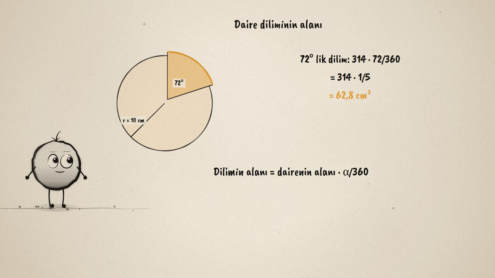
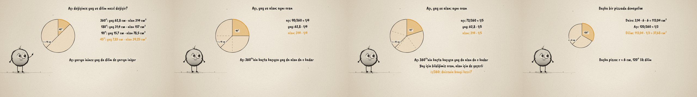

# Pizza Dilimi · The Area of a Sector

**▶ Tarayıcıda izleyin / Watch in the browser:** https://hakanatas.github.io/pizza-dilimi/ 
**⬇ MP4 + altyazılar / MP4 + subtitles:** [Releases](https://github.com/hakanatas/pizza-dilimi/releases) 
**✎ Kullanılan istem / The prompt behind it:** [PROMPT.md](PROMPT.md) 
**🎞 Bütün filmler / All films:** [Nokta'nın Filmleri](https://hakanatas.github.io/nokta-filmleri/?sinif=7)

> **TR —** 7. sınıf matematik "Geometrik Nicelikler" temasındaki MAT.7.4.8 öğrenme çıktısı için hazırlanmış, tamamen JavaScript ile çizilen 92 saniyelik mürekkep animasyonu. Yarıçapı 10 cm olan bir pizzanın alanı 314 cm²; 90°'lik bir dilimin alanı ne kadar? Merkez açı 360°, 180°, 90° ve 45° olurken yay (62,8 cm'den 7,85 cm'ye) ve dilimin alanı (314 cm²'den 39,25 cm²'ye) aynı oranda küçülüyor: açı, yay ve alan orantılı. Açı 360°'nin kaçta kaçıysa (1/4, 1/3, 1/5) yay çemberin, dilim de dairenin o kadarı. Yay için bilinen bağıntıdan analojiyle dilimin alanına varılıyor: yay = 2πr · α/360, dilim = πr² · α/360; 72°'lik dilim 62,8 cm². Son olarak yarıçapı 6 cm olan bir pizzadan 120°'lik dilim hesaplanıyor (37,68 cm²) ve üç dilimin bütün pizzayı verdiği kontrol ediliyor. Altyazılar Türkçe, İngilizce ya da ikisi birlikte seçilebilir.

A 92-second ink animation for **7th-grade maths**. Nokta, the ink character from [The Learning Ink](https://github.com/hakanatas/the-learning-ink), is the guide again. The slice is one function of its angle, `pizza(α)` in `scenes/scene1.js`, and the angle itself is a short list of keyframes (90° → 360° → 180° → 90° → 45° → …), so the arc, the filled sector and the angle label always move together.

## Learning outcome

MEB, Türkiye Yüzyılı Maarif Modeli, Ortaokul Matematik, 7th grade, "Geometrik Nicelikler" theme:

**MAT.7.4.8. Çemberde merkez açı ve gördüğü yay uzunluğu arasındaki ilişkiden yola çıkarak daire ve daire diliminin alanları arasındaki ilişkiye yönelik analojik akıl yürütebilme**
- a) Çemberde merkez açı ve gördüğü yay uzunluğu ile daire ve daire diliminin alanı arasındaki ilişkileri gözlemler.
- b) Çemberde merkez açı ve gördüğü yay uzunluğu ile daire ve daire diliminin alanı arasındaki ilişkiyi tespit eder.
- c) Çemberde merkez açı ve gördüğü yay uzunluğuyla daire ve daire diliminin alanı arasında kurulan ilişkiden hareketle daire diliminin alanına dair çıkarım yapar.

## Scenes

| # | Time | Scene | What happens | Outcome |
|---|---|---|---|---|
| 1 | 0–10 s | Bir dilim | A pizza of radius 10 cm (314 cm²) and a 90° slice. | a |
| 2 | 10–28 s | Açıyı değiştir | 360°, 180°, 90°, 45°: the arc and the slice halve with the angle. | a |
| 3 | 28–46 s | Aynı oran | 90° is 1/4, 120° is 1/3, 72° is 1/5 of the circle: arc and area too. | b |
| 4 | 46–64 s | Dilimin alanı | 314 · 72/360 = 62,8 cm²; by analogy with the arc, sector = πr² · α/360. | c |
| 5 | 64–80 s | Başka pizza | r = 6 cm, 120°: 37,68 cm², checked by three slices making the whole. | c |
| 6 | 80–92 s | Aklında kalsın | The slice is the angle's fraction of the circle. | a–c |

## Running it

- **Preview:** double-click `index.html` (it works offline).
- **MP4:** run `npm install` once, then `npm run export -- --format=horizontal --captions=tr`.
- **Subtitles and narration:** `npm run srt` writes `out/captions_*.srt` and `narration_notes.txt`.
- **Editing:**
  - Caption text, timings and narration notes: `captions.js`
  - Everything on screen is drawn by `LI.world(t)` in `scenes/scene1.js` (the pizza, the slice, the steps, the words); the other scenes only set the camera.
  - Nokta's poses: `src/draw/film.js`; layout for 16:9 and 9:16: `src/draw/kd.js`

It uses the same engine as The Learning Ink: `renderFrame(t)` as a pure function of time, seeded randomness, and frame-by-frame export.
